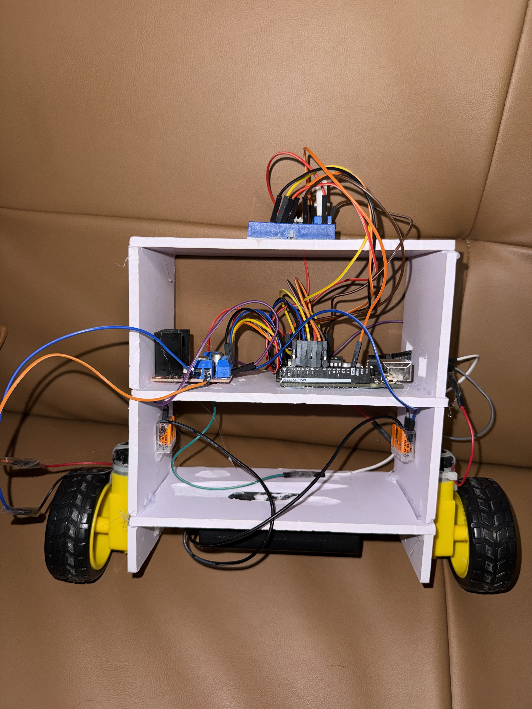

# Self-Balancing Robot

## Overview
This repository contains the hardware documentation, electrical schematics, and C-based control software for a custom-built, self-balancing robot. The system utilizes an Arduino Uno to read real-time orientation data via I2C from an MPU6050 IMU, processes the tilt angle, and actively maintains an upright position using a PID control loop.

## Live Demo
https://github.com/user-attachments/assets/7b5526c6-c11d-4ea7-9ab6-fbfd53dee1e7

## Hardware Architecture
The physical chassis is custom-cut from a 5mm PVC board to ensure a rigid chassis. The battery pack and hardware components were thoughtfully placed to ensure a centre of gravity near the centre of the body. The design was inspired by Rachel De Barros's YouTube tutorial: https://www.youtube.com/watch?v=eud5v0AUQew

* **Wiring Schematic:** [View Schematic](./hardware/wiring_schematic.png)
* **Bill of Materials:** [View Component List](./hardware/component_list.md)

Power is supplied by a 7.4V series 18650 lithium-ion pack, which is distributed between the L298N motor driver and the logic board to ensure stable voltage levels during high-torque balancing corrections.

Please see the photos in `/media` for details.

## Software & Control Theory
The balancing logic relies on continuous sensor polling and a custom-written PID controller designed to actively compensate for the physical kinematics of the hardware. 

*   **Sensor Fusion:** The raw accelerometer and gyroscope data from the MPU6050 are combined via a complementary filter to calculate a stable, noise-free tilt angle. A software low-pass filter is applied beforehand to strip high-frequency mechanical chassis vibrations from the accelerometer vectors.
*   **Custom PID Control Law:** The software calculates the error between the current angle and a dynamically adjustable setpoint. The Proportional, Integral, and Derivative terms compute the necessary recovery force to command the L298N motor driver.
*   **Anti-Windup Clamp:** To manage steady-state error without inducing runaway oscillations, the integral memory is strictly capped. Furthermore, the integral accumulator instantly flushes if the chassis crosses an unrecoverable 15-degree tipping point to prevent windup-induced crashes.
*   **Kinematic Mitigation:** A decoupled deadband PWM injection is utilized to overcome the static gearbox friction of the TT motors and baseline L298N voltage sag. This ensures that the mathematical PID output translates immediately into physical torque.
*   **Actuator Saturation Kill Switch:** If the chassis exceeds a 30-degree tilt, the required recovery velocity exceeds the physical RPM limit of the motors. The software instantly cuts power to prevent the robot from accelerating its own fall.

The program was made with assistance from Google's Gemini 3.1 Pro.

### Getting Started
1. Cut and glue the physical robot chassis together using the 5mm PVC boards.
2. Attach the hardware components using hot glue. Complete all wiring as per the schematic.
3. Find the natural point of balance of the robot using your hands, then rest the robot at this angle against a steady wall.
4. At the angle established in step 3, run the calibration sketch located in `/utils/MPU_Calibration` to generate the specific hardware offsets for your IMU.
5. Update the offset variables in the main program (`/src/main.ino`).
6. Upload the main program to the Arduino Uno.
7. Double-check the wiring, then activate the batteries. The robot should promptly begin to self-balance!
8. You will very likely need to tune the PID constants yourself depending on the assembly of your robot.

## Future Development
*   **Custom PCB:** Migration from the current breadboard prototype to a dedicated printed circuit board to minimize wiring impedance and improve structural reliability.
*   **Advanced Control:** Implementation of cascading PID loops for position and velocity control.
*   **Hardware Upgrades:** Utilizing stronger motors that generate more torque and achieve higher velocity, along with modern motor drivers utilizing MOSFET technology to reduce voltage drops.

## Acknowledgments
* **Rachel De Barros:** For the highly DIY-friendly foam/PVC chassis design and layout inspiration.
* **blinkmaker & Luis Ródenas:** For the MPU6050 calibration sketch used in this project's utilities (authored by blinkmaker, based on original code by Luis Ródenas).
